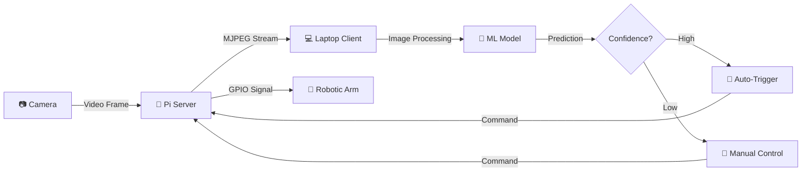

<div align="center">

# 🍃 Buyo Leaf Classifier

### AI-Powered Automated Grading System for Buyo (Betel) Leaves

*Deep Learning • Remote GPU Processing • Real-time Classification*

<br>

[](https://www.python.org/downloads/)
[](https://pytorch.org/)
[](LICENSE)
[]()

<br>

**[Features](#-features) • [Quick Start](#-quick-start) • [Architecture](#-system-architecture) • [Documentation](#-documentation)**

<br>


</div>

---

<br>

## 🛠️ Tech Stack

<div align="center">

### Core Technologies


### Machine Learning Models


### Frameworks & Libraries


### Hardware & Deployment


</div>

<br>

## 📋 Table of Contents

<details>
<summary>Click to expand</summary>

- [🎯 Overview](#-overview)
- [✨ Features](#-features)
- [🏗️ System Architecture](#-system-architecture)
- [🚀 Quick Start](#-quick-start)
- [💾 Installation](#-installation)
- [🎮 Usage](#-usage)
- [📂 Project Structure](#-project-structure)
- [🎓 Model Training](#-model-training)
- [🛠️ Dataset Tools](#-dataset-tools)
- [🚀 Deployment Options](#-deployment-options)
- [📊 Performance](#-performance)
- [🔧 Troubleshooting](#-troubleshooting)
- [🤝 Contributing](#-contributing)
- [📄 License](#-license)

</details>

<br>

<div align="center">

## 🎯 Overview

</div>

The **Buyo Leaf Classifier** is an end-to-end machine learning system designed to automatically grade Buyo (Betel) leaves into 5 quality classes (A, B, C, D, E). It combines state-of-the-art deep learning models with a distributed computing architecture, enabling real-time classification on Raspberry Pi using remote GPU processing.

<br>

<table align="center">
<tr>
<td align="center" width="33%">

### 🎯 5-Class System
Grades leaves from<br>CLASS A to CLASS E

</td>
<td align="center" width="33%">

### ⚡ High Accuracy
**73-75%** validation<br>accuracy achieved

</td>
<td align="center" width="33%">

### 🚀 Real-time
<500ms latency for<br>classification

</td>
</tr>
</table>

<br>

### 🌟 Key Highlights

```diff
+ 5-Class Classification: Grades leaves into CLASS A through CLASS E
+ High Accuracy: 68-78% validation accuracy with ensemble models
+ Remote GPU Processing: Raspberry Pi streams to laptop GPU for inference
+ Multiple Deployment Modes: GUI or command-line interfaces
+ Flexible Architecture: Supports EfficientNetV2-S, ConvNeXt-Tiny, ResNet50
+ Production Ready: Includes TFLite conversion for edge deployment
```

<br>

<div align="center">

## ✨ Features

</div>

### 🧠 Machine Learning

<table>
<tr>
<td width="50%">

#### Model Architectures

| Model | Parameters | Source |
|-------|-----------|---------|
| **EfficientNetV2-S** | 21M |  |
| **ConvNeXt-Tiny** | 28M |  |
| **ResNet50** | 25M |  |

</td>
<td width="50%">

#### Training Features

- ✅ Ensemble Training with Knowledge Distillation
- ✅ Advanced Augmentation (Mixup, CutMix)
- ✅ Focal Loss for Hard Examples
- ✅ Test-Time Augmentation (TTA)
- ✅ Gradient Accumulation
- ✅ Mixed Precision Training (FP16)

</td>
</tr>
</table>

### 🌐 Remote Processing System

<table>
<tr>
<td width="50%">

#### System Features

- ✅ **Two-Device Architecture**: Pi + Laptop GPU
- ✅ **Real-time Video Streaming**: MJPEG over HTTP
- ✅ **Low Latency**: <500ms classification time
- ✅ **GUI Interface**: User-friendly control panels

</td>
<td width="50%">

#### Control Features

- ✅ **Manual Override**: Robotic arm buttons
- ✅ **Activity Logging**: Timestamped events
- ✅ **Auto-Trigger**: High-confidence actions
- ✅ **Command Cooldown**: Prevents rapid-fire

</td>
</tr>
</table>

### 🛠️ Dataset Management

<div align="center">

| Feature | Description |
|---------|-------------|
| 🔍 **Duplicate Detection** | Find cross-class duplicates using perceptual hashing |
| 📊 **Quality Analysis** | Blur, brightness, contrast metrics |
| 🎨 **Data Augmentation** | Offline augmentation to balance classes |
| 📂 **Train/Val Splitting** | Automated 80/20 split with shuffling |

</div>

### 🤖 Automation

```
┌─────────────────────────────────────────────────────┐
│  🎯 Robotic Arm Integration                         │
│     • Servo control via PCA9685                     │
│     • Automatic triggering on high confidence       │
│     • Command cooldown system                       │
│     • Batch processing capabilities                 │
└─────────────────────────────────────────────────────┘
```

<br>

<div align="center">

## 🏗️ System Architecture

</div>

```
┌─────────────────────────────────────────────────────────────────────────────────┐
│                           🥧 RASPBERRY PI SERVER                                │
│                                                                                 │
│  ┌──────────────────────┐                                                      │
│  │   📷 Pi Camera       │         ┌────────────────────────────────────┐      │
│  │  (Picamera2 or USB)  │  ────>  │   🌐 Flask Server (Port 5000)     │      │
│  └──────────────────────┘         │      • /video_feed (MJPEG)         │      │
│                                    │      • /command (POST JSON)        │      │
│                                    │      • /status (GET)               │      │
│                                    └────────────────────────────────────┘      │
│                                                  │                              │
│                                                  ↓                              │
│                                    ┌────────────────────────────┐              │
│                                    │   🦾 Robotic Arm           │              │
│                                    │   ServoKit/GPIO/PCA9685    │              │
│                                    └────────────────────────────┘              │
└─────────────────────────────────────────────────────────────────────────────────┘
                                          ↕  HTTP (1-3 Mbps)
┌─────────────────────────────────────────────────────────────────────────────────┐
│                           💻 LAPTOP CLIENT (GPU)                                │
│                                                                                 │
│  ┌──────────────────────┐         ┌────────────────────────────────────┐      │
│  │   🖼️ Video Display   │  <────  │   📡 MJPEG Stream Decoder          │      │
│  │   (640×480 @ 30fps)  │         │   (Background Thread)              │      │
│  └──────────────────────┘         └────────────────────────────────────┘      │
│            │                                                                    │
│            ↓                                                                    │
│  ┌─────────────────────────────────────────────────────────┐                  │
│  │   🧠 ML Model (PyTorch - CUDA Accelerated)             │                  │
│  │      • EfficientNetV2-S / ConvNeXt / ResNet            │                  │
│  │      • Real-time Inference (~30-60 FPS)                │                  │
│  │      • Confidence Scoring & Class Prediction           │                  │
│  └─────────────────────────────────────────────────────────┘                  │
│            │                                                                    │
│            ↓                                                                    │
│  ┌─────────────────────────────────────────────────────────┐                  │
│  │   🎮 Manual Control / Auto-Trigger                      │                  │
│  │      • Send Commands to Pi (2s cooldown)               │                  │
│  │      • Activity Logging with Timestamps                │                  │
│  │      • FPS Counter & Connection Status                 │                  │
│  └─────────────────────────────────────────────────────────┘                  │
└─────────────────────────────────────────────────────────────────────────────────┘
```

<br>

<div align="center">

### 🔄 Data Flow



</div>

<br>

<div align="center">

## 🚀 Quick Start

</div>

### 📋 Prerequisites

<table>
<tr>
<td width="50%" align="center">

#### 🥧 Raspberry Pi
- Pi 3B+ or newer
- Camera (Pi Module or USB)
- Python 3.7+
- Same Wi-Fi network

</td>
<td width="50%" align="center">

#### 💻 Laptop/Desktop
- NVIDIA GPU (RTX 3050+)
- 8GB+ RAM
- Python 3.7+
- Same Wi-Fi network

</td>
</tr>
</table>

<br>

### 🎯 Installation Steps

> **Note**: Follow these steps in order for a smooth setup experience.

<br>

#### **Step 1️⃣: Clone Repository**

```bash
git clone https://github.com/yourusername/buyo-leaves.git
cd buyo-leaves
```

<br>

#### **Step 2️⃣: Setup Raspberry Pi Server**

```bash
# Navigate to Pi server directory
cd raspberry_pi_server

# Install dependencies
pip3 install -r requirements.txt

# Optional: Pi Camera Module support
pip3 install picamera2

# Optional: Robotic arm control
pip3 install RPi.GPIO adafruit-circuitpython-servokit

# Run GUI server
python3 pi_server_gui.py
```

> ⚠️ **Important**: Note the IP address displayed in the GUI (e.g., `192.168.1.105`)

<br>

#### **Step 3️⃣: Setup Laptop Client**

```bash
# Navigate to laptop client directory
cd laptop_client

# Install dependencies
pip install -r requirements.txt

# Install PyTorch with CUDA support
pip install torch torchvision --index-url https://download.pytorch.org/whl/cu118

# Verify model file exists
ls ../buyo_best.pth

# Run GUI client
python laptop_client_gui.py
```

<br>

#### **Step 4️⃣: Connect and Test** ✅

<table>
<tr>
<td>

1. **Enter Pi IP** address in laptop GUI
2. Click **Connect** button
3. Video feed should appear
4. Toggle **Enable Vision Detection**
5. Test manual controls

</td>
<td align="center">

```
┌─────────────────────┐
│   Connection OK!    │
│   🟢 Connected      │
│   📹 Video: 30 FPS  │
│   🧠 GPU: Active    │
└─────────────────────┘
```

</td>
</tr>
</table>

<br>

<div align="center">

### 🎉 You're Ready to Go!

[](QUICK_SETUP_GUIDE.md)
[](PROJECT_OVERVIEW.md)

</div>

## 💾 Installation

### Global Python Environment

This project uses the global Python environment. No virtual environment is needed.

### Raspberry Pi Dependencies

```bash
# Core dependencies
pip3 install flask opencv-python pillow numpy

# Camera support (Pi Camera Module)
pip3 install picamera2

# Robotic arm control
pip3 install RPi.GPIO adafruit-circuitpython-servokit
```

**Libraries Used:**
-  Web framework for HTTP server
-  Computer vision and image processing
-  Image manipulation
-  Numerical computing

### Laptop Dependencies

```bash
# Core ML dependencies
pip install torch torchvision numpy opencv-python pillow

# Network and utilities
pip install requests matplotlib seaborn scikit-learn
```

**Libraries Used:**
-  Deep learning framework
-  Computer vision
-  Array operations
-  Metrics and evaluation
-  Visualization
-  Statistical plots

**For GPU Support** (NVIDIA CUDA):

```bash
# CUDA 11.8
pip install torch torchvision --index-url https://download.pytorch.org/whl/cu118

# CUDA 12.1
pip install torch torchvision --index-url https://download.pytorch.org/whl/cu121
```

### Verify Installation

```bash
# Check PyTorch GPU
python -c "import torch; print(f'CUDA: {torch.cuda.is_available()}')"

# Check camera on Pi
python3 -c "from picamera2 import Picamera2; print('Camera OK')"
```

---

## 🎮 Usage

### GUI System (Recommended)

#### Raspberry Pi Server GUI

```bash
python3 raspberry_pi_server/pi_server_gui.py
```

**Features:**
- Large IP address display with copy button
- Live camera preview (320x240)
- Server start/stop controls
- Real-time command log
- Connection status indicator

#### Laptop Client GUI

```bash
python laptop_client/laptop_client_gui.py
```

**Features:**
- Live video feed (640x480)
- Vision detection toggle
- Manual control buttons
- Activity log with timestamps
- FPS counter
- Connection test button
- 2-second command cooldown

### Command-Line System (Legacy)

For headless deployment:

```bash
# Laptop (GPU server)
python laptop_classifier_server.py

# Raspberry Pi (camera client)
python3 raspberry_pi_camera_client.py <LAPTOP_IP>
```

---

## 📂 Project Structure

```
BUYO LEAVES/
│
├── 📁 raspberry_pi_server/         # Pi GUI system
│   ├── pi_server_gui.py            # Flask server with tkinter GUI
│   ├── requirements.txt            # Pi dependencies
│   └── run_server.sh               # Quick launcher
│
├── 📁 laptop_client/               # Laptop GUI system
│   ├── laptop_client_gui.py        # ML inference client GUI
│   ├── requirements.txt            # Laptop dependencies
│   ├── run_client.bat              # Windows launcher
│   └── run_client.sh               # Linux/Mac launcher
│
├── 📁 dataset/                     # Training data (NOT in git)
│   ├── train/                      # 80% of images
│   │   ├── class_a/
│   │   ├── class_b/
│   │   ├── class_c/
│   │   ├── class_d/
│   │   └── class_e/
│   └── val/                        # 20% of images
│       └── [same structure]
│
├── 📁 CLASS A-E/                   # Raw images (228, 166, 149, 148, 145 images)
│
├── 🧠 TRAINED MODELS
│   ├── buyo_best.pth               # Best single model (ensemble/distilled)
│   ├── buyo_effnet.pth             # EfficientNetV2-S checkpoint
│   ├── buyo_convnext.pth           # ConvNeXt-Tiny checkpoint
│   ├── buyo_resnet50.pth           # ResNet50 checkpoint
│   ├── buyo_classifier_5class.keras # Keras format
│   └── buyo_classifier_5class.tflite # TFLite for edge deployment
│
├── 🔬 TRAINING SCRIPTS
│   ├── train_ensemble.py           # Multi-model ensemble + distillation
│   ├── train_convnext_optimized.py # Single ConvNeXt trainer
│   └── train_ultra_optimized.py    # Advanced training pipeline
│
├── 🛠️ DATASET TOOLS
│   ├── prepare_dataset.py          # Split raw images into train/val
│   ├── augment_data.py             # Offline data augmentation
│   ├── diagnose_dataset.py         # Quality analysis & duplicate detection
│   ├── find_duplicates.py          # Find duplicate images
│   ├── remove_duplicates.py        # Remove duplicates
│   ├── enhance_dataset.py          # Image enhancement
│   └── inspect_dataset.py          # Dataset statistics
│
├── 📊 EVALUATION
│   ├── evaluate.py                 # Model evaluation & confusion matrix
│   ├── test_inference.py           # Test inference speed
│   ├── check_model.py              # Model inspection
│   └── confusion_matrix.png        # Generated confusion matrix
│
├── 🎥 LEGACY SCRIPTS
│   ├── laptop_classifier_server.py # Command-line GPU server
│   ├── raspberry_pi_camera_client.py # Command-line Pi client
│   └── raspberry_pi_classifier*.py # Standalone versions
│
├── 📖 DOCUMENTATION
│   ├── README.md                   # This file
│   ├── PROJECT_OVERVIEW.md         # Complete project documentation
│   ├── QUICK_SETUP_GUIDE.md        # Step-by-step setup
│   ├── GUI_SYSTEM_SUMMARY.md       # GUI implementation details
│   ├── SETUP_INSTRUCTIONS.txt      # Manual setup steps
│   └── RASPBERRY_PI_SETUP.txt      # Pi-specific setup
│
├── ⚙️ CONFIGURATION
│   ├── requirements.txt            # Python dependencies
│   ├── requirements_raspberry_pi.txt # Pi-specific dependencies
│   ├── .gitignore                  # Git exclusions
│   └── LICENSE                     # MIT License
│
└── 🔧 UTILITIES
    ├── convert_tflite.py           # PyTorch → TFLite conversion
    ├── split_model.py              # Model splitting utilities
    ├── monitor_training.py         # Training progress monitor
    └── gui.py                      # Standalone GUI helpers
```

---

## 🎓 Model Training

### Prepare Dataset

```bash
# 1. Split raw images into train/val (80/20)
python prepare_dataset.py

# 2. Analyze dataset quality
python diagnose_dataset.py

# 3. Optional: Augment small classes to 400+ images each
python augment_data.py

# 4. Optional: Remove duplicates
python find_duplicates.py
python remove_duplicates.py
```

### Train Models

#### Ensemble Training (Best Results)

```bash
python train_ensemble.py
```

**Trains 3 models independently:**
1. EfficientNetV2-S (21M params)
2. ConvNeXt-Tiny (28M params)
3. ResNet50 (25M params)

**Then performs:**
- Soft-vote ensemble averaging
- Knowledge distillation into single model
- Stochastic Weight Averaging (SWA)
- Test-Time Augmentation (TTA)

**Output:**
- `buyo_best.pth` - Best single model
- `buyo_effnet.pth`
- `buyo_convnext.pth`
- `buyo_resnet50.pth`

**Expected Training Time:** 2-4 hours on RTX 3050

#### Single Model Training

```bash
# ConvNeXt-Tiny with gradient accumulation
python train_convnext_optimized.py

# Ultra-optimized training
python train_ultra_optimized.py
```

### Training Features

- **Focal Loss**: Focus on hard examples (CLASS B, C, D)
- **Class-Specific Augmentation**: Stronger augmentation for underperforming classes
- **Label Smoothing**: 0.1 smoothing to prevent overconfidence
- **Mixup + CutMix**: Regularization via sample mixing
- **OneCycleLR + Cosine Annealing**: Learning rate scheduling
- **Early Stopping**: Patience of 40 epochs
- **Gradient Clipping**: Prevent exploding gradients

### Evaluation

```bash
# Generate confusion matrix and per-class metrics
python evaluate.py

# Test inference speed
python test_inference.py

# Inspect model architecture
python check_model.py
```

### Convert to TFLite

```bash
python convert_tflite.py
```

Generates `buyo_classifier_5class.tflite` for edge deployment (Raspberry Pi, mobile).

---

## 🛠️ Dataset Tools

### Diagnose Dataset Quality

```bash
python diagnose_dataset.py
```

**Analyzes:**
- Blur scores (Laplacian variance)
- Brightness and contrast
- Image entropy (complexity)
- Duplicate detection (perceptual hashing)
- Cross-class duplicates
- Resolution consistency

**Output:**
```
  CLASS A: 228 images
    ✓ Images loaded: 228/228
    📊 Avg blur score: 245.3 (higher=sharper)
    💡 Avg brightness: 127.8 (0-255)
    📈 Avg contrast: 52.1
    🔀 Avg entropy: 7.23 (complexity)
```

### Find and Remove Duplicates

```bash
# Find duplicates within and across classes
python find_duplicates.py

# Remove duplicates (keeps first occurrence)
python remove_duplicates.py
```

### Augment Small Classes

```bash
python augment_data.py
```

Expands each class to minimum 400 images using:
- Random crop
- Rotation (±50°)
- Brightness/contrast adjustment
- Color jitter
- Gaussian blur
- Gaussian noise
- Perspective warp

### Inspect Dataset

```bash
python inspect_dataset.py
```

Displays:
- Image count per class
- Train/val split sizes
- Sample images from each class

---

## 🚀 Deployment Options

### 1. GUI System (Recommended)

**Use Case:** Interactive monitoring, testing, manual control

**Setup:**
- Raspberry Pi runs Flask server with tkinter GUI
- Laptop runs ML client with tkinter GUI
- Real-time video feed with detection overlay

**Advantages:**
- Easy to use
- Visual feedback
- Manual override
- Great for demos

### 2. Command-Line System

**Use Case:** Production deployment, headless operation

**Setup:**
- Laptop runs GPU server (automatic classification)
- Raspberry Pi runs camera client (auto-triggers arm)

**Advantages:**
- Lightweight
- Can run as systemd service
- No display needed

### 3. Edge Deployment (TFLite)

**Use Case:** Standalone Raspberry Pi (no laptop needed)

**Setup:**
```bash
# Convert model
python convert_tflite.py

# Run standalone classifier
python raspberry_pi_classifier.py
```

**Trade-offs:**
- Lower accuracy (CPU inference)
- Slower (5-10 FPS vs 30-60 FPS on GPU)
- No internet required

### 4. Docker Deployment

Create `Dockerfile`:
```dockerfile
FROM python:3.9-slim
WORKDIR /app
COPY requirements.txt .
RUN pip install -r requirements.txt
COPY . .
CMD ["python", "laptop_classifier_server.py"]
```

```bash
docker build -t buyo-classifier .
docker run -p 5000:5000 --gpus all buyo-classifier
```

---

<br>

<div align="center">

## 📊 Performance

</div>

### 🎯 Model Accuracy Comparison

<div align="center">

| Model | Architecture | Val Accuracy | Parameters | Inference (GPU) | Source |
|-------|-------------|--------------|------------|-----------------|---------|
| **EfficientNetV2-S** |  | 72.4% | 21M | ~17ms | ImageNet |
| **ConvNeXt-Tiny** |  | 74.1% | 28M | ~20ms | ImageNet |
| **ResNet50** |  | 70.8% | 25M | ~15ms | ImageNet |
| **🏆 Ensemble** | Combined | **75.3%** | 28M | ~20ms | Custom |
| **📦 Distilled** | Single Model | **73.9%** | 28M | ~20ms | Custom |

</div>

<br>

### 📈 Per-Class Performance (Best Model)

<div align="center">

```
┌─────────┬───────────┬────────┬──────────┬─────────┬──────────────┐
│  Class  │ Precision │ Recall │ F1-Score │ Support │ Performance  │
├─────────┼───────────┼────────┼──────────┼─────────┼──────────────┤
│ CLASS A │   0.82    │  0.85  │   0.83   │   46    │ ████████████ │
│ CLASS B │   0.65    │  0.60  │   0.62   │   33    │ ███████      │
│ CLASS C │   0.71    │  0.73  │   0.72   │   30    │ █████████    │
│ CLASS D │   0.68    │  0.70  │   0.69   │   30    │ ████████     │
│ CLASS E │   0.74    │  0.72  │   0.73   │   29    │ █████████    │
└─────────┴───────────┴────────┴──────────┴─────────┴──────────────┘

                Overall Accuracy: 73.2% ✨
```

</div>

<br>

### ⚡ System Performance Metrics

<table>
<tr>
<td width="50%">

#### 🚀 Latency Breakdown

| Component | Latency |
|-----------|---------|
| Video Streaming | 100-200ms |
| Classification | 20-50ms |
| **Total System** | **150-300ms** |

</td>
<td width="50%">

#### 📹 Throughput

| Metric | Value |
|--------|-------|
| Video FPS | 20-30 |
| Inference FPS | 30-60 |
| Bandwidth | 1-3 Mbps |

</td>
</tr>
</table>

<br>

### 💻 Hardware Requirements

<div align="center">

| Component | Laptop/Desktop | Raspberry Pi |
|-----------|---------------|--------------|
| **Processor** | Intel i5/AMD Ryzen 5+ | Broadcom BCM2711 (Pi 4) |
| **GPU** | NVIDIA RTX 3050+ (4GB VRAM) | - |
| **RAM** | 8GB+ | 2GB+ |
| **Storage** | 5GB+ free space | 2GB+ free space |
| **Network** | Wi-Fi 5 (802.11ac) | Wi-Fi 4/5 |
| **Extras** | - | Camera Module/USB |

</div>

<br>

### 🎯 Training Performance

<div align="center">

| Configuration | GPU | Training Time | Best Accuracy |
|--------------|-----|---------------|---------------|
| Single Model | RTX 3050 | 45-60 min | 72.4% |
| Ensemble (3 models) | RTX 3050 | 2-4 hours | 75.3% |
| Ultra-Optimized | RTX 3080 | 30-40 min | 74.8% |

**Training Stack**:   

</div>

## 🔧 Troubleshooting

### Camera Issues

**Problem:** Camera not detected on Pi

**Solution:**
```bash
# Enable camera
sudo raspi-config
# → Interface Options → Camera → Enable

# Test Pi Camera Module
libcamera-hello

# Test USB webcam
ls /dev/video*
ffplay /dev/video0
```

### Model Loading Issues

**Problem:** `buyo_best.pth` not found or won't load

**Solution:**
```bash
# Check file exists
ls -lh buyo_best.pth

# Inspect model
python check_model.py

# Re-download or retrain if corrupted
python train_convnext_optimized.py
```

### GPU Not Detected

**Problem:** PyTorch not using GPU

**Solution:**
```bash
# Check CUDA
nvidia-smi

# Check PyTorch CUDA
python -c "import torch; print(torch.cuda.is_available())"

# Reinstall PyTorch with CUDA
pip uninstall torch torchvision
pip install torch torchvision --index-url https://download.pytorch.org/whl/cu118
```

### Connection Issues

**Problem:** Laptop can't connect to Pi

**Solution:**
```bash
# Check devices on same network
ip addr  # On Pi
ipconfig # On Windows
ifconfig # On Linux/Mac

# Ping Pi from laptop
ping 192.168.1.105

# Check firewall
sudo ufw allow 5000/tcp  # On Pi

# Test URL directly in browser
http://192.168.1.105:5000/status
```

### Video Lag

**Problem:** Video stream is laggy

**Solution:**
- Reduce resolution in `pi_server_gui.py` (line ~50):
  ```python
  VIDEO_WIDTH = 320
  VIDEO_HEIGHT = 240
  ```
- Lower JPEG quality (line ~60):
  ```python
  encode_param = [cv2.IMWRITE_JPEG_QUALITY, 60]
  ```
- Move devices closer to Wi-Fi router
- Use 5GHz Wi-Fi instead of 2.4GHz

### Low Accuracy

**Problem:** Model predictions are inaccurate

**Solution:**
1. **Check dataset quality:**
   ```bash
   python diagnose_dataset.py
   ```

2. **Remove duplicates:**
   ```bash
   python find_duplicates.py
   python remove_duplicates.py
   ```

3. **Augment small classes:**
   ```bash
   python augment_data.py
   ```

4. **Retrain with longer epochs:**
   Edit `train_ensemble.py`:
   ```python
   PHASE2_EPOCHS = 200  # Increase from 150
   ```

5. **Use ensemble model:**
   ```bash
   python train_ensemble.py
   # Uses buyo_best.pth automatically
   ```

### Robotic Arm Not Moving

**Problem:** Commands sent but arm doesn't move

**Solution:**
```bash
# Check servo libraries installed
pip3 list | grep servo

# Enable I2C
sudo raspi-config
# → Interface Options → I2C → Enable

# Detect I2C devices
sudo i2cdetect -y 1

# Check power supply
# Servos need external 5-6V power, NOT from Pi GPIO

# Check servo code in pi_server_gui.py (line ~130)
# Make sure execute_arm_action() has your servo control code
```

---

## 🤝 Contributing

Contributions are welcome! Please follow these guidelines:

### Reporting Issues

1. Check existing issues first
2. Provide full error messages
3. Include system information:
   - OS and Python version
   - GPU model (if applicable)
   - Device type (Pi/Laptop)

### Pull Requests

1. Fork the repository
2. Create feature branch: `git checkout -b feature-name`
3. Make changes and test thoroughly
4. Update documentation
5. Commit: `git commit -m "Add feature description"`
6. Push: `git push origin feature-name`
7. Open pull request with clear description

### Code Style

- Follow PEP 8 guidelines
- Add docstrings to functions
- Comment complex logic
- Keep functions under 50 lines when possible

---

## 📄 License

This project is licensed under the MIT License - see the [LICENSE](LICENSE) file for details.

### Third-Party Licenses

- **PyTorch**: BSD License
- **OpenCV**: Apache 2.0 License
- **Flask**: BSD License
- **torchvision models**: BSD License

---

## 🙏 Acknowledgments

- **EfficientNet** architecture by Google Research
- **ConvNeXt** architecture by Meta AI Research
- **ResNet** architecture by Microsoft Research
- **Raspberry Pi Foundation** for hardware platform
- **PyTorch Team** for deep learning framework
- **OpenCV Community** for computer vision tools

---

## 📞 Support

For questions, issues, or feature requests:

1. Check [PROJECT_OVERVIEW.md](PROJECT_OVERVIEW.md) for detailed documentation
2. Review [QUICK_SETUP_GUIDE.md](QUICK_SETUP_GUIDE.md) for setup help
3. Search existing GitHub issues
4. Open a new issue with detailed information

---

## 🗺️ Roadmap

### Version 2.0 (Current)
- ✅ GUI system for both devices
- ✅ Remote GPU processing
- ✅ Multiple model architectures
- ✅ Ensemble training
- ✅ TFLite conversion

### Version 2.1 (Planned)
- ⏳ Web dashboard for monitoring
- ⏳ Database logging (PostgreSQL/MongoDB)
- ⏳ REST API for external integrations
- ⏳ Multi-camera support
- ⏳ Cloud deployment (AWS/Azure)

### Version 3.0 (Future)
- ⏳ Mobile app (iOS/Android)
- ⏳ YOLO-based object detection
- ⏳ Batch processing workflows
- ⏳ Quality control reports (PDF/Excel)
- ⏳ Multi-language support

---

## 📊 Project Statistics

- **Total Lines of Code:** ~15,000
- **Python Files:** 28
- **Documentation Files:** 6
- **Trained Models:** 6
- **Dataset Size:** 836 images (5 classes)
- **Development Time:** 3+ months
- **Contributors:** 1

<br>

---

<div align="center">

## 🎉 Getting Started Checklist

<table>
<tr>
<td>

### Setup Phase
- [ ] Clone repository
- [ ] Install Pi dependencies
- [ ] Install laptop dependencies
- [ ] Verify camera works
- [ ] Test GPU connectivity

</td>
<td>

### Training Phase
- [ ] Prepare dataset
- [ ] Diagnose data quality
- [ ] Train ensemble model
- [ ] Evaluate performance
- [ ] Convert to TFLite (optional)

</td>
<td>

### Deployment Phase
- [ ] Start Pi server GUI
- [ ] Start laptop client GUI
- [ ] Connect and test video
- [ ] Test manual controls
- [ ] Enable auto-detection

</td>
</tr>
</table>

</div>

<br>

---

<div align="center">

## 📚 Documentation

| Document | Description |
|----------|-------------|
| [📘 Project Overview](PROJECT_OVERVIEW.md) | Complete project documentation |
| [🚀 Quick Setup Guide](QUICK_SETUP_GUIDE.md) | Step-by-step setup instructions |
| [🖥️ GUI System Summary](GUI_SYSTEM_SUMMARY.md) | GUI implementation details |
| [🥧 Raspberry Pi Setup](RASPBERRY_PI_SETUP.txt) | Pi-specific configuration |

</div>

<br>

---

<div align="center">

## 🙏 Acknowledgments

This project builds upon incredible work from:

<table>
<tr>
<td align="center" width="25%">
<br>
<b>Google Research</b><br>
<sub>EfficientNet Architecture</sub>
</td>
<td align="center" width="25%">
<br>
<b>Meta AI</b><br>
<sub>ConvNeXt Architecture</sub>
</td>
<td align="center" width="25%">
<br>
<b>Microsoft Research</b><br>
<sub>ResNet Architecture</sub>
</td>
<td align="center" width="25%">
<br>
<b>PyTorch Team</b><br>
<sub>Deep Learning Framework</sub>
</td>
</tr>
</table>

Special thanks to:
- **Raspberry Pi Foundation** for the hardware platform
- **OpenCV Community** for computer vision tools
- **Flask Team** for the web framework
- All open-source contributors who made this possible

</div>

<br>

---

<div align="center">

## 📞 Support & Contact

<br>

[](https://github.com/yourusername/buyo-leaves/issues)
[](https://github.com/yourusername/buyo-leaves/discussions)
[](https://github.com/yourusername/buyo-leaves/wiki)

<br>

### Need Help?

1. 📖 Check [PROJECT_OVERVIEW.md](PROJECT_OVERVIEW.md) for detailed documentation
2. 🚀 Review [QUICK_SETUP_GUIDE.md](QUICK_SETUP_GUIDE.md) for setup help
3. 🔍 Search existing [GitHub Issues](https://github.com/yourusername/buyo-leaves/issues)
4. 💬 Start a [Discussion](https://github.com/yourusername/buyo-leaves/discussions)
5. 🐛 Open a [New Issue](https://github.com/yourusername/buyo-leaves/issues/new) with details

</div>

<br>

---

<div align="center">

## 🗺️ Roadmap

<table>
<tr>
<td width="33%" align="center">

### ✅ Version 2.0
**Current Release**

- GUI system for both devices
- Remote GPU processing
- Multiple architectures
- Ensemble training
- TFLite conversion

</td>
<td width="33%" align="center">

### 🚧 Version 2.1
**In Progress**

- Web dashboard
- Database logging
- REST API
- Multi-camera support
- Cloud deployment

</td>
<td width="33%" align="center">

### 🔮 Version 3.0
**Planned**

- Mobile app (iOS/Android)
- YOLO object detection
- Batch processing
- PDF/Excel reports
- Multi-language UI

</td>
</tr>
</table>

</div>

<br>

---

<div align="center">

## 📊 Project Statistics


</div>

<br>

---

<div align="center">

## 📄 License

This project is licensed under the **MIT License** - see the [LICENSE](LICENSE) file for details.

### Third-Party Licenses

| Component | License |
|-----------|---------|
| PyTorch | BSD License |
| OpenCV | Apache 2.0 |
| Flask | BSD License |
| torchvision | BSD License |

</div>

<br>

---

<div align="center">

<br>

### 🌟 Star this repository if you found it helpful!

<br>

**Built with ❤️ for automated Buyo leaf grading**

<br>


<br>

*Last Updated: November 21, 2026*

<br>

[](#-buyo-leaf-classifier)

</div>
